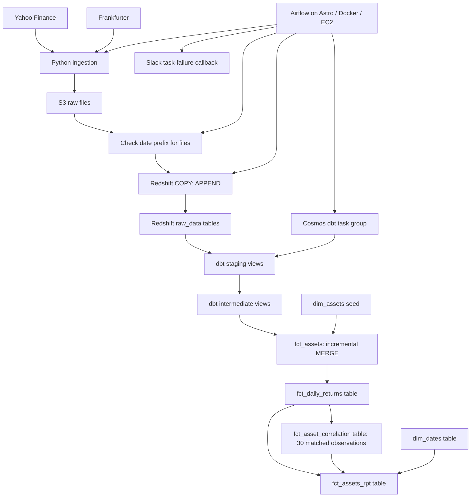
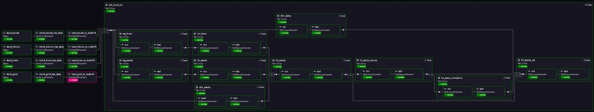

# Multi-Asset Correlation Pipeline — Redshift

This project collects daily prices for the S&P 500, KLCI, Bitcoin and GLD, then stores them in S3. Airflow loads the files into Amazon Redshift with `COPY`. dbt transforms the data into MYR prices, daily returns and rolling correlations over 30 shared observations. Airflow runs in Docker through Astro, with EC2 as the deployment host.

This is the Redshift implementation of the [Athena-based Multi-Asset Correlation Pipeline](https://github.com/hannanrazalli/assets-correlation-pipeline). Both projects explore the same analytical question with different AWS stacks. **CI/CD for this Redshift repository is planned and has not been implemented.**

## Project question

How have the daily returns of selected asset proxies moved together over time, and what might that tell us when considering diversification? The pipeline calculates pairwise correlations over 30 dates on which all four assets have returns.

A correlation near 1 means two return series tended to move in the same direction; near -1 means they tended to move in opposite directions; near 0 means little linear relationship. Correlation alone does not measure portfolio risk, prove causation or predict future returns. The project does not send alerts when correlations cross a threshold.

USD prices are converted to MYR. If an exchange rate is missing, the model currently uses `1.0`, so the affected USD prices are not valid MYR conversions. Read [Limitations](#limitations) before interpreting results.


## Data sources

| Series | Source | Role | Raw format |
| --- | --- | --- | --- |
| S&P 500 (`^GSPC`) | Yahoo Finance through `yfinance` | US equity index proxy | Parquet |
| KLCI (`^KLSE`) | Yahoo Finance through `yfinance` | Malaysian equity index proxy | Parquet |
| Bitcoin (`BTC-USD`) | Yahoo Finance through `yfinance` | Crypto price series | Parquet |
| SPDR Gold Shares (`GLD`) | Yahoo Finance through `yfinance` | Gold ETF proxy | Parquet |
| USD/MYR | Frankfurter `/v2/rates` | Currency conversion | NDJSON |

The indices are market proxies, not portfolio holdings. GLD is a gold ETF, not a spot-gold price. Stock and ETF data follow market trading days; Bitcoin trades every day. Staging uses `BTC_USD` as the internal Bitcoin ticker.

## Architecture



Redshift stores raw data and runs the dbt SQL. S3 files are loaded directly into warehouse tables without Glue crawlers or Athena. Airflow runs separately from the warehouse.

| Aspect | Athena implementation | Redshift implementation |
| --- | --- | --- |
| Raw access | Glue crawlers and Data Catalog over S3 | COPY into Redshift raw tables |
| Transformation engine | Athena | Redshift |
| Price fact | Incremental Iceberg table | Incremental Redshift table |
| Returns, correlations and report | Views | Tables rebuilt by dbt runs |
| CI/CD | GitHub Actions in the Athena repository | Planned |

Cost and performance have not been benchmarked between the implementations.

## Repository layout

```text
dags/daily_dag.py                    Daily ingestion, file checks, COPY and dbt
include/ingestions/api/              Stocks, Bitcoin, gold and forex loaders
include/utilities/                   Cosmos configuration and Slack callback
include/dbt/asset_correlation_redshift/
  dbt_project.yml                   Materializations, schemas, sort and distribution
  models/staging/                   Source casts and asset-series union
  models/intermediate/              Natural-key deduplication and surrogate keys
  models/marts/                     Prices, returns, correlations and reporting
  macros/audit_columns.sql          dbt execution metadata
  seeds/dim_assets.csv              Asset lookup
Dockerfile                          Astro Runtime and separate dbt environment
tests/dags/test_dag_example.py       Generated Astro example checks
```

## Pipeline behaviour

The `00_Daily_Asset_Pipeline` DAG runs daily, with `catchup=False` and one active run at a time. Airflow passes the run date (`ds`) to each loader. Yahoo Finance loaders request that date and skip the write if no data is returned. An empty result does not distinguish a market closure from a provider issue. The forex loader checks the HTTP response but does not check for an empty result before writing. The DAG is not scheduled around each exchange's market close.

Files use date-based paths such as `raw/stocks/year=2026/month=10/day=17/`. Each branch checks whether its logical-date prefix contains S3 keys before loading. A missing prefix skips that branch's COPY task. The dbt operators use `none_failed`, allowing transformations to proceed when upstream loads are skipped and no upstream task failed.

The file check confirms key existence, not valid content, freshness or completeness. An empty forex file or a file from an earlier run can still satisfy it. COPY uses `APPEND`, so loading the same date again can duplicate raw rows.

| dbt object | Materialization | Behaviour |
| --- | --- | --- |
| `stg_assets`, `stg_forex` | Views | Cast fields and combine the four asset series |
| `int_assets`, `int_forex` | Views | Generate surrogate keys and deduplicate natural keys |
| `dim_assets` | Seed | Ticker, asset name, asset class and base currency |
| `dim_dates` | Table | Calendar dates from 2020 through 2030 |
| `fct_assets` | Incremental table | Join prices, FX and asset metadata; merge by `asset_key` |
| `fct_daily_returns` | Table | Percentage change from each asset's previous observation |
| `fct_asset_correlation` | Table | Six pair correlations over 30 complete-case observations |
| `fct_assets_rpt` | Table | Calendar, price, return and correlation columns |

Each correlation uses the current row and previous 29 dates with returns for all four assets. Results appear after 30 shared observations, which can span more than 30 calendar days. The existing `_30d` column names are retained. Redshift SQL computes Pearson correlation using rolling averages and population standard deviations, with a zero-denominator guard.

### Reprocessing and execution metadata

The incremental fact selects dates from **the latest fact date minus three calendar days, inclusive**, onward. This can include four date labels through the latest date, plus newer observations. Loaders do not automatically fetch previous days again. Re-ingest revised data and load it into Redshift before expecting the merge to use it. Older backfills need a separate rebuild or loading procedure.

Intermediate views order duplicates by `_staged_at`. Staging timestamps are calculated when queried, so they do not record arrival time or reliably identify the newest conflicting source row. Raw duplicates remain in Redshift even when intermediate views select one row per key.

The audit macro adds timestamps and dbt invocation IDs to staging, intermediate and `fct_assets`. This describes dbt execution, not a full history of data loads or revisions.

## Validation and deployment

There are 36 configured generic dbt tests:

| Layer | Count | Checks |
| --- | --- | --- |
| Sources | 4 | Non-null source dates |
| Staging | 9 | Required fields and expected currencies/tickers |
| Intermediate | 4 | Unique, non-null surrogate keys |
| Marts | 17 | Fact keys, relationships, converted prices, correlations and calendar/report dates |
| Seed | 2 | Unique, non-null ticker |

Counts describe configured checks, not a guarantee that they pass on every run. These checks do not establish freshness, completeness, correct FX conversion or statistical validity. An empty correlation table can pass non-null checks because it has no rows to fail them.

Generated Astro DAG tests are included. Their tag and retry expectations do not match the current DAG: it has no tags and sets one retry, while the example expects tags and at least two retries. Adapt those checks before using them as CI acceptance criteria.

**Redshift CI/CD is planned.** This repository currently has no GitHub Actions workflows. Astro/Docker can run on EC2, but resource provisioning, automated deployment and deployment health checks are not supplied here. Deployment depends on your existing host, Docker/Astro installation, environment and warehouse network access.

Slack task-failure notifications use `slack_alert_conn` and include task details and an Airflow log link. The callback does not set a request timeout or check the HTTP response; delivery is not verified.



## How to run

### Prerequisites and AWS resources

You need Docker, Astro CLI, an S3 bucket, a reachable Redshift endpoint and credentials with access to these resources. On EC2, containers must reach Redshift and the source APIs. This repository does not provision AWS resources or create raw tables.

Create the following tables before running the DAG. Types and column ordering must match the actual files, especially for Parquet loads:

| Redshift table | S3 prefix | Fields expected by staging | COPY format |
| --- | --- | --- | --- |
| `raw_data.raw_forex` | `raw/forex/` | `date`, `base`, `quote`, `rate` | JSON `auto` |
| `raw_data.raw_stocks` | `raw/stocks/` | `date`, `gspc`, `klse` | Parquet |
| `raw_data.raw_bitcoin` | `raw/bitcoin/` | `date`, `"btc-usd"` | Parquet |
| `raw_data.raw_gold` | `raw/gold/` | `date`, `gld` | Parquet |

Sources are hardcoded to database `dev` and schema `raw_data` in `models/staging/_sources.yml`. Point `redshift_default` at the same database, or update source configuration and raw-load destinations together. `DBT_TARGET_SCHEMA` changes the dbt output schema prefix, not the raw database or schema.

The AWS connection needs S3 read/write access for ingestion, file checks and loading. Redshift needs valid S3 COPY authorization and access to relevant encryption keys. The database user needs permission to load raw tables and create dbt schemas, tables and views.

### Configure and start Airflow

```bash
git clone https://github.com/hannanrazalli/assets-correlation-pipeline-redshift.git
cd assets-correlation-pipeline-redshift
```

Create a local `.env` file with your values; it is ignored by Git:

```dotenv
BUCKET_NAME=your-bucket
DBT_TARGET=dev
DBT_TARGET_SCHEMA=analytics
DBT_EXECUTABLE_PATH=/usr/local/airflow/dbt_venv/bin/dbt
FOREX_URL=https://api.frankfurter.dev/v2/rates
```

`BUCKET_NAME` must exist when the DAG is parsed. `FOREX_URL` is optional. The Dockerfile uses Astro Runtime `3.3-8` and creates a Python 3.12 environment with dbt Core and dbt-redshift `~=1.9.0`. Setting `DBT_EXECUTABLE_PATH` explicitly selects that environment; otherwise Cosmos uses dbt from PATH or `/usr/local/bin/dbt`. Root Python dependencies are not fully pinned.

```bash
astro dev start
```

Open `http://localhost:8080` and configure:

- `aws_default`: AWS access for ingestion, prefix checks and S3-to-Redshift loading.
- `redshift_default`: Redshift host, database, user, password and port. COPY and the Cosmos user/password profile mapping both use this connection.
- `slack_alert_conn`: the callback joins host and password to form the webhook URL. Put the URL prefix in host and secret suffix in password.

`airflow_settings.yaml` is a blank template. It does not supply working connections. Keep credentials and webhooks out of tracked files. Check DAG imports and access before triggering `00_Daily_Asset_Pipeline`.

With default dbt schema generation, `DBT_TARGET_SCHEMA=analytics` produces `analytics_staging`, `analytics_intermediate` and `analytics_marts`; the seed uses `analytics`. Marts use a `price_date` sort/distribution key, with `dim_dates` distributed to all nodes.

A fresh setup does not load history automatically and will not produce correlations immediately. Load enough historical prices and FX into raw tables and populate `dim_assets` first. Reruns append raw data, so plan duplicate handling when loading history.

### Run dbt manually

The repository does not include a manual `profiles.yml`. Create one outside the repository, for example at `~/.dbt/profiles.yml`:

```yaml
asset_correlation_redshift:
  target: dev
  outputs:
    dev:
      type: redshift
      host: "{{ env_var('REDSHIFT_HOST') }}"
      user: "{{ env_var('REDSHIFT_USER') }}"
      password: "{{ env_var('REDSHIFT_PASSWORD') }}"
      port: 5439
      dbname: dev
      schema: analytics
      threads: 4
```

Set these environment variables in the shell running dbt. Manual dbt does not automatically load the root `.env` or reuse Airflow connections. In a compatible environment with dbt-redshift installed:

```bash
cd include/dbt/asset_correlation_redshift
dbt deps
dbt seed
dbt run
dbt test
```

These commands write to Redshift. Use a separate target schema for isolated validation. A full refresh rebuilds `fct_assets` from raw history; plan it around downstream dependencies and warehouse capacity.

## Inspecting results

The analytical success criterion is dated rows in `fct_assets_rpt` with all six correlations populated after at least 30 shared return observations. The report includes calendar dates through the date of its last build; row presence alone does not establish that asset data exists for a date. A successful Airflow run does not establish complete or statistically reliable results.

Run this query in Redshift, replacing `analytics_marts` if your target schema prefix differs:

```sql
SELECT
    price_date,
    corr_sp500_klse_30d,
    corr_sp500_btc_30d,
    corr_sp500_gold_30d,
    corr_klse_btc_30d,
    corr_klse_gold_30d,
    corr_btc_gold_30d
FROM analytics_marts.fct_assets_rpt
WHERE corr_sp500_klse_30d IS NOT NULL
ORDER BY price_date DESC
LIMIT 10;
```

Each row is a date-specific snapshot of how returns moved together across the rolling window. Missing data affects the observations included. The `_30d` suffix means 30 matched observations, not necessarily 30 calendar days. Check loaded data before claiming particular correlation patterns.

## Limitations

- **Missing FX:** USD series use `1.0` when FX is missing. Non-null price tests do not detect this incorrect conversion. A consistent missing-FX policy and treatment of affected history are still needed.
- **Return alignment:** `LAG()` uses each asset's previous available price. Monday equity returns can span Friday to Monday while Bitcoin spans Sunday to Monday. Matching date labels does not align return intervals or exchange closing times.
- **Complete-case selection:** Missing one return removes that date from all six correlations, including pairs without the missing asset.
- **Precision and sample size:** Returns and correlations are rounded to two decimals. Thirty observations do not guarantee stability. Constant returns can produce null correlations and fail non-null checks.
- **Raw duplication and revisions:** APPEND can duplicate raw rows. View timestamps cannot reliably order conflicting revisions. Older corrections fall outside the incremental filter and require separate reprocessing.
- **Input checks:** Prefix existence is not a content or freshness check. Empty responses, partial market data and stale files need additional validation.
- **Table refreshes:** Returns, correlations and reports reflect their last successful build. Rebuilding history can affect warehouse load as data grows.
- **Expansion:** New tickers require ingestion, seed, staging, test, pivot, correlation and reporting changes.
- **Operations:** CI/CD, resource provisioning, dedicated warehouse integration tests, FX quality checks, a BI dashboard and correlation alerts are not included. AWS cost has not been measured; Redshift, S3 and EC2 contribute to it.
